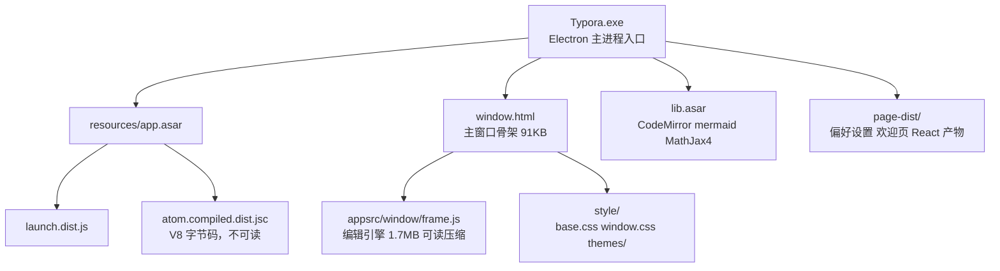
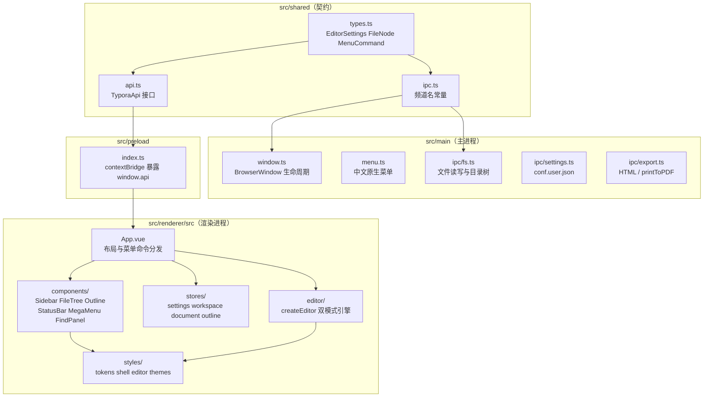
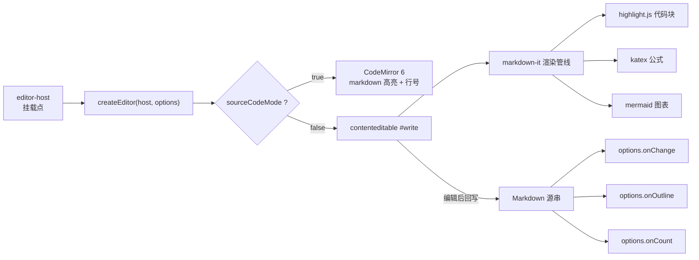
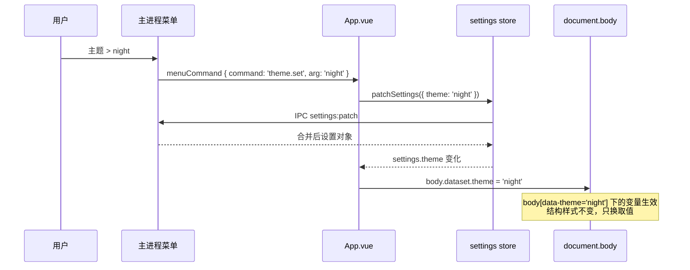

# 架构文档

<!-- 由 df-arch 生成的各 US 架构文档按时间合并而成；每个块由 df-arch:<US> 标记界定。 -->
<!-- df-arch:US-20261114220214-0001-Typora像素级复刻 -->
<!-- df-arch:US-20261114220214-0001-Typora像素级复刻 -->

# 架构：Typora 像素级复刻（US-20261114220214-0001-Typora像素级复刻）

## 1. 参照物：Typora 1.14.15 的实际结构

解包 `typora-setup-x64.exe`（Inno Setup 6，414 个条目）后，安装目录只有一棵 `app/` 树，没有 `app.asar` 之外的打包层：

关键事实：主进程逻辑（`atom.compiled.dist.jsc`）是 V8 字节码，无法还原为源码；渲染层（`frame.js`、`window.html`、`style/`）是明文，可以作为行为与视觉规格读取，但按用户决定不作为运行时代码复用。

## 2. 目标结构：本工程分层

依赖方向是单向的：`shared` 不依赖任何一层；`main` 与 `preload` 只依赖 `shared`；`renderer` 只依赖 `preload` 暴露的 `window.api` 与 `shared` 的类型。渲染进程不允许直接 import `electron`。

## 3. 编辑区组件结构

## 4. 主题机制

## 5. 与 Typora 的像素对齐锚点

| 锚点 | Typora 1.14.15 取值 | 本工程落点 |
|---|---|---|
| 侧栏宽度 | `--sidebar-width: 240px` | `styles/tokens.css` |
| 状态栏高度 | 28px，Windows 下 30px，上边框 1px `#ddd` | `styles/shell.css` `footer.ty-footer` |
| 编辑区盒子 | `max-width: 860px`（github 主题）、`padding: 30px`、`padding-bottom: 100px` | `styles/editor.css` `#write` |
| 根字号 | `html { font-size: 16px }`（github 主题） | 主题文件 `--write-font-size` |
| 正文行高 | 1.6 | 主题文件 `--write-line-height` |
| h1 / h2 | 2em / 1.6em，带 1px 下边框 | `styles/editor.css` + github 主题覆盖 |
| 代码块 | 浅灰底 `#f7f7f7`、等宽字体、无边框圆角的软块 | 主题 `--code-block-bg` |
| 窗口 chrome | Windows 原生 frame + 原生菜单栏 | `BrowserWindow` 不设 `titleBarStyle` |

## 6. 未纳入本期的参照物

- `page-dist/` 下的偏好设置与欢迎页（React 产物）需要等价重写为 Vue 页面，本期不做。
- `lib.asar` 中的 MathJax4、pdf-lib、aws-sdk、Jimp 由 npm 生态的等效库替代，不直接搬运。
<!-- /df-arch:US-20261114220214-0001-Typora像素级复刻 -->
