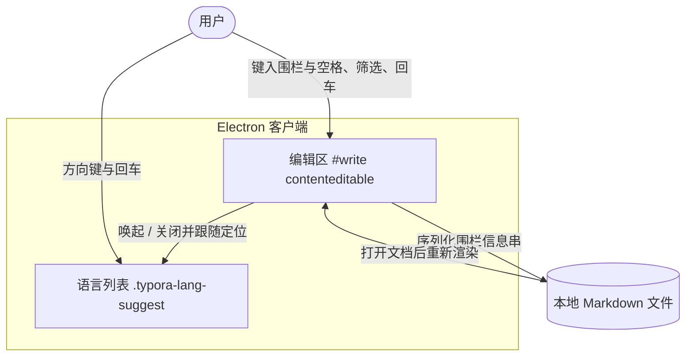
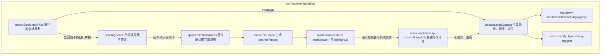
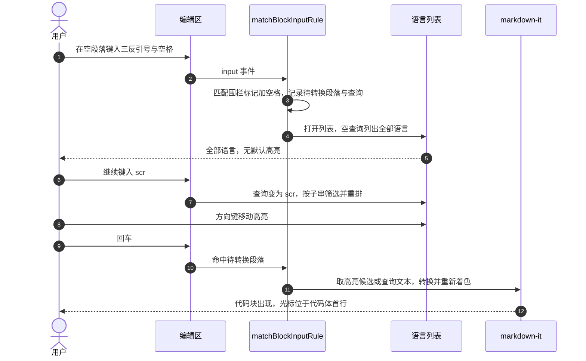
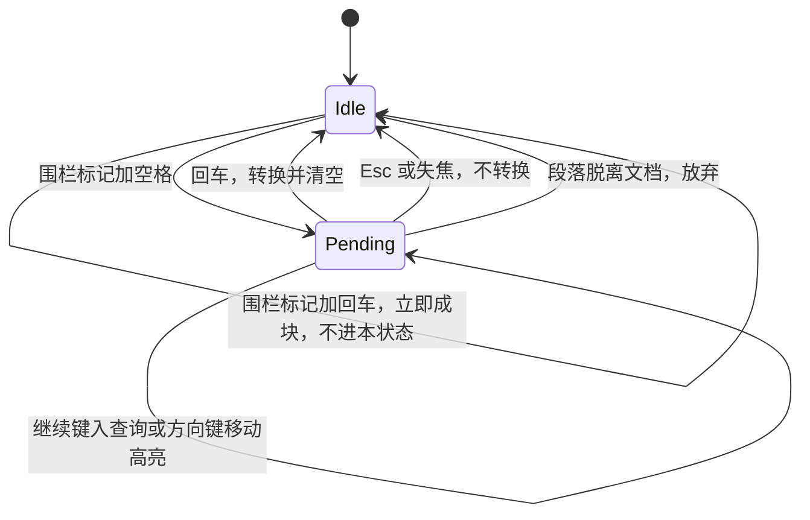
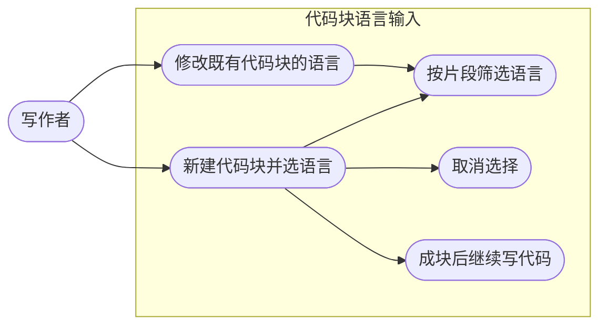
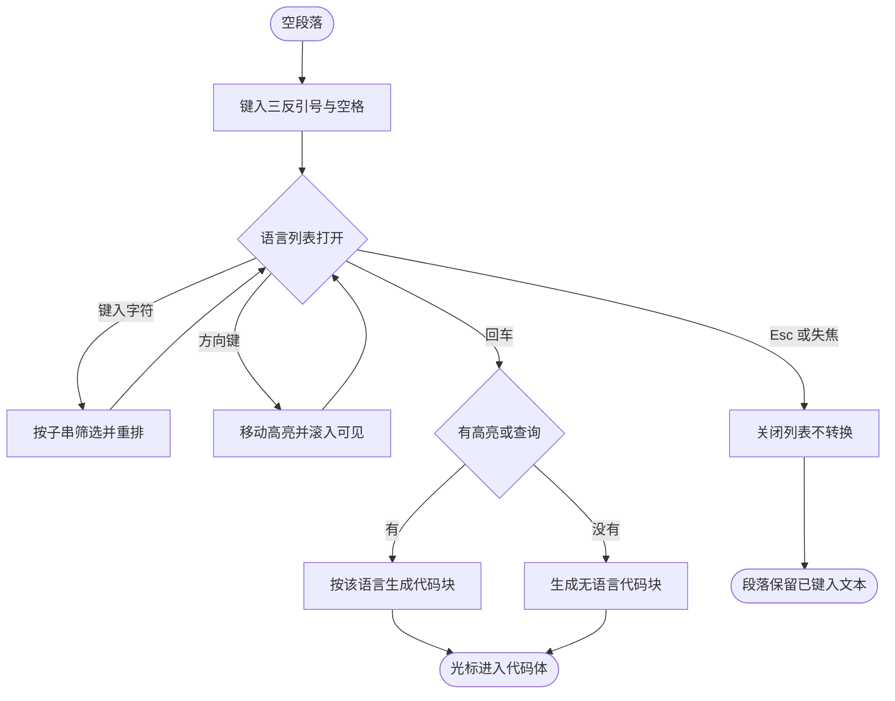

# 架构：代码块语言输入（US-20261115213400-0005-代码块语言输入）

| 项目 | 内容 |
|---|---|
| 文档版本 | v1.0 |
| 编写人 | lead（df-arch） |
| 最后更新 | 2026-11-15 |
| 文档状态 | 已定稿 |
| 读者 | 开发 |

## 变更记录

| 版本 | 日期 | 修改人 | 变更说明 |
|---|---|---|---|
| v1.0 | 2026-11-15 | lead | 初稿创建：只保留与本次变更相关的章节，模板的 2 与 7 章不适用 |

## 1. 引言与背景

### 1.1 编写目的

本文只覆盖本次变更引入的结构：编辑区里「输入围栏 → 选语言 → 成块」这条链路，以及它与既有语言胶囊编辑链路的关系。全局分层、主题机制与像素锚点见 docs/arch.md 的 US-20261114220214-0001 架构块，此处不重复。

模板章节按需删减：第 2 章（架构原则与约束）与第 7 章（物理部署与网络）不适用——本变更是桌面单机渲染层内部的交互改动，不引入服务、容器或网络边界。保留的章节沿用模板编号，便于与原文档对照。

### 1.2 业务背景

原版 Typora 把「想写代码块」和「写哪种语言」合成一次输入：语言列表随输入即时出现，输入即筛，回车即成块。本工程此前的实现是「空格即成块、光标落进代码体、语言只能事后点胶囊再改」，缺了选择语言的那一步。本变更补上语言列表，并把新建与修改合并到同一条链路。

### 1.3 术语

| 术语 | 说明 |
|---|---|
| 围栏 | Markdown 中以三个及以上反引号或波浪号开头的代码块定界符 |
| 待转换段落 | 已输入围栏标记与空格、但尚未变成代码块的段落 |
| 胶囊 | 代码块右下角的语言输入框，DOM 为 .code-tooltip 下的 .ty-cm-lang-input |

## 3. 系统上下文

本变更不新增进程、不新增网络调用；所有交互都发生在渲染进程的编辑区与一个浮层面板之间，文档仍以本地 Markdown 文件为唯一持久化载体。

## 4. 逻辑架构与组件

依赖方向未变：全部落在 editor/ 内部，src/shared 的 IPC 契约、主进程 src/main、预加载 src/preload 都不参与；列表数据仍来自渲染进程内的 highlight.js 语言注册表，没有新增跨进程调用。

## 5. 核心流程

既有代码块改语言：点击胶囊后由 openLangEditor 聚焦胶囊，以胶囊现有语言为初始查询打开同一个列表；筛选与高亮规则与新建路径一致；回车或点选后由 commitLangEdit 写回围栏信息串并重新渲染。

异常与降级：

| 场景 | 检测方式 | 处理 |
|---|---|---|
| 面板打开期间切换文档或整篇重渲染 | 转换前校验段落是否仍在文档中 | 清空待转换状态、关闭面板，不生成代码块 |
| 段落文本不再是「标记 + 查询」形态（粘贴多行、删掉反引号） | 每次输入后重新匹配 | 只关面板，不改文本，按普通输入继续 |
| 取消（Esc 或失焦） | 段落失焦或 Esc 键 | 关闭面板，段落保留已键入文本 |

## 6. 状态与数据

待转换状态只存在于内存，不落盘，也不进入 Markdown；它在文档里没有对应表示——这一点决定了取消后的段落文本必须由用户自己收拾。

| 阶段 | 载体 | 是否进入 Markdown |
|---|---|---|
| 查询文本 | 待转换段落中的真实文本 | 是（取消时保留，转换时被删除） |
| 语言列表与候选 | 浮层 .typora-lang-suggest | 否（挂在 .typora-app 下，不在 #write 内） |
| 胶囊文本 | .ty-cm-lang-input，带 md-tooltip-remove 标记 | 否（序列化时按类名过滤） |
| 语言 | pre.md-fences 的 lang 属性 | 是（写成围栏信息串） |

## 8. 非功能性设计

| 指标 | 目标 | 验证方式 |
|---|---|---|
| 列表唤起 | 按键到面板可见不超过 100ms（含语言表首次构建） | 真机键录屏或 CDP 打点计时 |
| 首屏渲染 | 全部语言条目（200 条规模）在一帧 16.7ms 内完成列表构建与定位 | 同上的性能打点 |
| 筛选响应 | 每次按键到列表更新不超过 50ms | 同上 |
| 可恢复性 | 面板打开期间 Esc 与失焦都必须回到可编辑状态，除段落文本外不留其它中间态 | 手测加 parity 用例 |

不做服务端可观测性；回归仍以 scripts/parity/checks.mjs 的断言与 scripts/pixel-diff.cjs 的像素比对为准。

## 9. 风险与演进

| 风险 | 触发条件 | 影响 | 应对 |
|---|---|---|---|
| 取消后残留文本被当成围栏 | 段落停在「三反引号加语言名」后保存并重开 | 文档被解析成代码块 | 已记入基线 Risks；后续可在序列化层对行首反引号做转义 |
| 两条入口语义不同 | 用户按空格还是按回车结尾 | 行为差异需要学习成本 | 基线的子决策里写明：空格选语言、回车走快捷通道 |
| 语言表与 Typora 不一致 | hljs 注册集与原版 CodeMirror 模式集不同 | 个别语言名对不上 | 以 listCodeLanguages() 为唯一来源，别名表在渲染层维护 |

演进方向：若后续要支持「记住上次语言」，应做成与原版 defaultCodeLang 对应的设置项，而不是恢复本次移除的隐式兜底。

## 10. UML 视图

### 10.1 用例图

### 10.2 活动图

